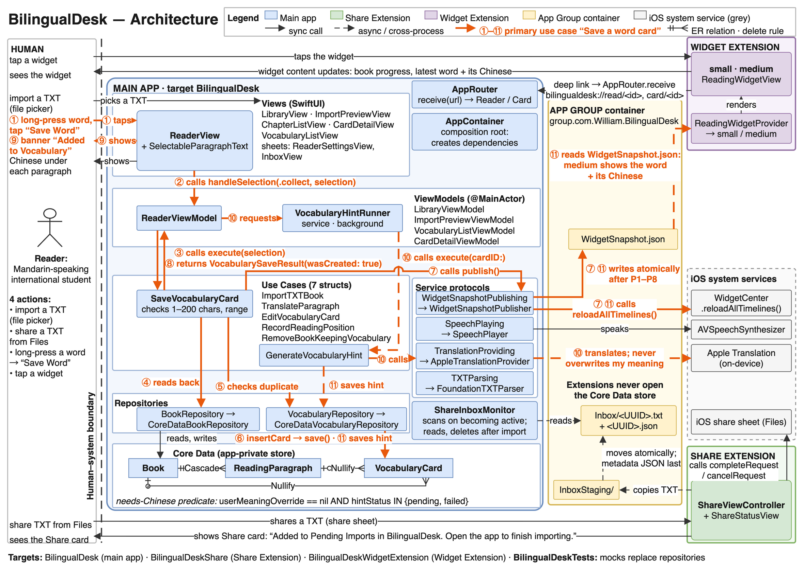
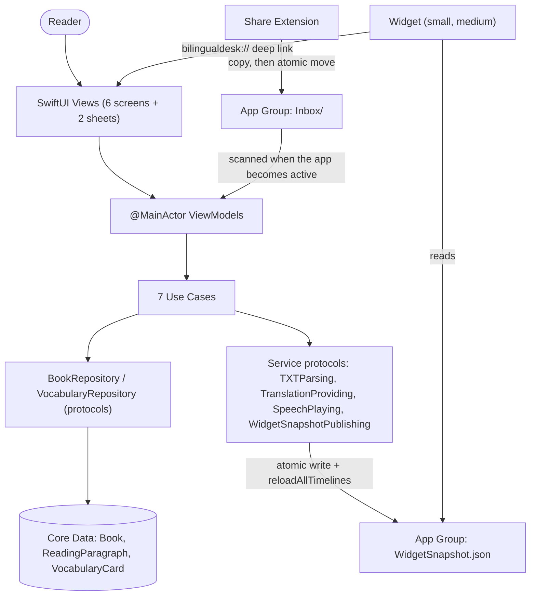

# BilingualDesk

An iOS app for a Mandarin-speaking international student in Sydney who reads self-chosen English novels, saved as plain-text (TXT) files, on an iPhone. Each English paragraph is followed by an on-device Chinese translation; a long-pressed word can be defined, pronounced and saved to Vocabulary together with the sentence it came from. TXT files can be shared into the app from Files, and a Home Screen widget returns to the book in progress and the latest word card.

Course: Advanced iOS Development — Assessment 3 (Platform-Integrated Solution)  
Repository: https://github.com/LyphardRover/BilingualDesk  
Report: see the submitted PDF

## 1. Project overview

| Item | Value |
|---|---|
| Platform | iPhone only, iOS 26.0 or later |
| Built with | Xcode 27.0 (27A266a), iOS 27 SDK, Swift 6.4 compiler in Swift 5 language mode |
| Tested on | iPhone 13 Pro (iOS 27.0.1); iOS Simulator iPhone 18 Pro (iOS 27.0) |
| Frameworks | SwiftUI, UIKit, Combine, Core Data, Foundation, CryptoKit, Translation, NaturalLanguage, AVFoundation, WidgetKit, UniformTypeIdentifiers, XCTest — no third-party packages |
| Extensions | Share Extension, Widget Extension (small and medium) |
| Database | Core Data (3 related entities) |

Screens (the interface is in English; Chinese appears only as content: paragraph translations, machine Chinese hints and the reader's own meanings):

| Screen | Purpose |
|---|---|
| Library | Books in reading order, search by title, “Pending imports: N” card, “Remove from Library” |
| Import Preview | Title, detected encoding, paragraph splitting rule, paragraph and chapter count, first 5 paragraphs |
| Bilingual Reader | English paragraphs with Chinese below; long-press menu “Define”, “Save Word”, “Pronounce”; “Read Aloud from Here” |
| Contents | Jump to a detected chapter |
| Vocabulary | Word cards, search, “Needs Chinese Only” filter |
| Word Card | Machine Hint, My Meaning, context sentence, paragraph translation, “Go to Source” |
| Sheets | Reading Settings; Pending Imports |

## 2. Domain context

The stakeholder is a Mandarin-speaking international master's student in Sydney reading English novels outside class. Students from China are the largest group of international students in Australia (Australian Government Department of Education, 2026). Reading a novel without help is estimated to need 8,000–9,000 word families (Nation, 2006), while Chinese master's students who met university entry requirements knew just under 8,000 (Trenkic & Warmington, 2019). Even readers with a dictionary at hand looked up only a small share of the unknown words (Hulstijn et al., 1996), while glosses, especially first-language glosses, supported vocabulary learning (Yanagisawa et al., 2020). BilingualDesk therefore keeps translation, word lookup and word collection on the reading page, and stores each word with its sentence for later review. Full problem statement and references: PDF Section 1.

## 3. Architecture summary

View → `@MainActor` ViewModel (`ObservableObject`) → Use Case (`struct`) → Repository protocol → Core Data. `AppContainer` is the composition root; dependencies are passed through initialisers.



The same diagram appears in PDF Section 3. A compact text version:



Use Cases (each has domain rules, a typed error enum with human-readable messages that say what happened and what to do next, and at least one unit test):

| Use Case | Main business rule (rule IDs in the design document) |
|---|---|
| `ImportTXTBook` | Max 10,000,000 bytes; UTF-8 (with or without BOM) or UTF-16 with BOM only; duplicate content (SHA-256 of raw bytes) is not imported twice |
| `TranslateParagraph` | A valid cached translation is reused without calling the translator |
| `SaveVocabularyCard` | Selection 1–200 characters; the same range in the same paragraph is never saved twice |
| `GenerateVocabularyHint` | A late machine hint never overwrites the reader's own meaning |
| `EditVocabularyCard` | My Meaning ≤ 500 characters; an empty meaning is saved as an empty value and shown as “Left Blank” |
| `RecordReadingPosition` | A position outside the book is rejected without saving |
| `RemoveBookKeepingVocabulary` | Removing a book deletes its text but keeps its word cards with their saved context |

Layering rules: Views never read or write data; ViewModels never import Core Data; only the four files in `BilingualDesk/Persistence/` import Core Data; extensions compile only the shared files they need.

Project structure:

```text
BilingualDesk/            main app (App, Domain, Persistence, Import, Features, Services, Sharing, Shared, Resources)
BilingualDeskShare/       Share Extension
BilingualDeskWidget/      Widget Extension
BilingualDeskTests/       unit and integration tests
docs/                     architecture diagram, sample TXT, screenshots
```

## 4. Extensions and why

**Share Extension — getting the reader's own TXT into the app.**
Scenario: the student finds an English novel as a TXT file in Files (or received in a chat). Instead of opening the app and navigating a file picker, they tap Share → BilingualDesk. The extension appears only when exactly one plain-text item is shared: a `.txt` file, or a passage of text selected in an app such as Notes. A file is copied into the App Group (`InboxStaging/<UUID>.txt` → atomic move to `Inbox/<UUID>.txt`, metadata `Inbox/<UUID>.json` written last); shared text is saved the same way as UTF-8, named “Shared Text” when it has no name. The extension shows “Added to Pending Imports in BilingualDesk. Open the app to finish importing.” and always closes with `completeRequest` or `cancelRequest`. When the app becomes active it scans the inbox and shows “Pending imports: N” at the top of the library; in the import preview the reader edits the title, checks the detected encoding and picks the paragraph rule, and the inbox file is removed once it is imported or confirmed as already in the library. The extension never opens the database.

**Widget (small and medium) — resuming in a short gap between classes.**
Scenario: the student has a few minutes between classes. The small widget shows the book in progress and its progress; tapping it opens the reader at the saved paragraph (`bilingualdesk://read/<book UUID>`). The medium widget adds the latest word card and the number of cards still missing Chinese; tapping the card opens it (`bilingualdesk://card/<card UUID>`). The widget reads `WidgetSnapshot.json` from the App Group. The app rewrites the snapshot and calls `WidgetCenter.shared.reloadAllTimelines()` after every relevant change: app launch, import, book removal, word card added / edited / deleted, machine hint saved or marked failed, and reading position saved when leaving the reader or entering the background. It does not reload while scrolling or reading aloud, to respect WidgetKit's refresh budget.

If the App Group is unavailable, the library and reader keep working; the library shows an exact configuration message and the widget shows “Open BilingualDesk once to finish setup”.

## 5. Database choice and why

BilingualDesk uses **Core Data** in the main app's private container.

- The data is personal (the full text of the reader's own books, reading positions, and word cards with private notes), used by one person on one iPhone, must load instantly while reading, and must work offline. Nothing needs to be shared with other users, so CloudKit would add an iCloud account requirement and a network dependency without solving a problem this stakeholder has.
- The domain has real relationships: `Book` 1—* `ReadingParagraph` (Cascade delete), `Book` 1—* `VocabularyCard` (Nullify), `ReadingParagraph` 1—* `VocabularyCard` (Nullify). A word card copies its sentence, paragraph translation and book title, so it stays meaningful after its book is removed.
- Domain queries use predicates, e.g. "cards still missing Chinese": `userMeaningOverride == nil AND hintStatus IN {"pending", "failed"}`; duplicate detection on `Book.contentHash` (indexed; checked with a count before insert, because Core Data rejects a uniqueness constraint on `Book` while `ReadingParagraph.book` is a mandatory to-one inverse); chapter list `isChapterHeading == YES`.
- All access goes through the `BookRepository` and `VocabularyRepository` protocols, so tests replace them with mocks.
- The extensions do not open the Core Data store. They exchange small files through the App Group instead (inbox files and a widget snapshot).

## 6. App Group identifier

```text
group.com.William.BilingualDesk
```

Enabled on the targets `BilingualDesk`, `BilingualDeskShare` and `BilingualDeskWidgetExtension`. The same string appears in:

- `BilingualDesk/BilingualDesk.entitlements`
- `BilingualDeskShare/BilingualDeskShare.entitlements`
- `BilingualDeskWidget/BilingualDeskWidgetExtension.entitlements`
- `SharedConfiguration.appGroupID` in `BilingualDesk/Shared/SharedConfiguration.swift`

Container layout:

```text
<App Group container>/
├── Inbox/            <UUID>.txt + <UUID>.json   (written by Share, read and deleted by the app)
├── InboxStaging/     temporary copies made by Share
└── WidgetSnapshot.json                          (written by the app, read by the widget)
```

## 7. Setup instructions

Requirements: a Mac with Apple silicon and macOS 26.6 or later; Xcode 27.0 with the iOS 27 platform installed (Xcode → Settings → Components); an Apple ID (a free Personal Team works, including App Groups).

1. Clone and open:
   ```sh
   git clone https://github.com/LyphardRover/BilingualDesk.git
   cd BilingualDesk
   open BilingualDesk.xcodeproj
   ```
2. Signing: for each of `BilingualDesk`, `BilingualDeskShare` and `BilingualDeskWidgetExtension`, open Signing & Capabilities, keep "Automatically manage signing" on and choose the same Team.
3. Identifiers: this project uses the prefix `com.William` (App Group `group.com.William.BilingualDesk`). Building with a different team: App Group IDs belong to one team, so replace `com.William` with your own unique prefix in all of these places:
   - Bundle IDs: `com.William.BilingualDesk`, `com.William.BilingualDesk.Share`, `com.William.BilingualDesk.Widget`, `com.William.BilingualDeskTests`
   - App Groups capability of the three targets above (this updates the three `.entitlements` files)
   - `SharedConfiguration.appGroupID` in `BilingualDesk/Shared/SharedConfiguration.swift`
   - URL Types identifier `com.William.BilingualDesk.navigation` (Info tab of the app target; the URL scheme stays `bilingualdesk`)
4. Run in the Simulator: choose the `BilingualDesk` scheme and an iOS 27 simulator, then Run. Apple's Translation framework does not work in the Simulator, so the reader shows “The Simulator doesn’t support system translation. English text and word cards still work; view the Chinese on an iPhone.”; everything else works.
5. Run on an iPhone: connect the phone, turn on Developer Mode (Settings → Privacy & Security), choose the phone as the run destination and Run. The first time, trust the developer certificate in Settings → General → VPN & Device Management. With a free team the app must be reinstalled from Xcode every 7 days.
6. Translation on the iPhone: if the English and Chinese (Simplified) translation languages are not downloaded yet, the reader shows “Prepare English–Chinese Translation”; tap it once to download them (needs a network connection). Afterwards translation works offline.
7. Try the main path with `docs/BilingualDeskSample.txt`: share it from Files to BilingualDesk, import it from the “Pending imports: N” card, long-press “curious” and tap “Save Word”, then add the small and medium widgets to the Home Screen.

## 8. Testing

Run all tests (replace the destination with a simulator listed by `xcodebuild -showdestinations -scheme BilingualDesk`):

```sh
xcodebuild test -project BilingualDesk.xcodeproj -scheme BilingualDesk \
  -destination 'platform=iOS Simulator,name=iPhone 18 Pro'
```

22 unit tests (Use Case tests with mock repositories and mock services, plus 5 TXT parser tests); 3 integration tests use an in-memory Core Data store and are marked as integration tests.

| ID | Test | Use Case / rule |
|---|---|---|
| U01 | `test_importingNewTXT_savesBookWithAllParagraphs_andPublishesWidget` | ImportTXTBook |
| U02 | `test_importingSameTXTTwice_returnsBookAlreadyInLibrary_withoutSecondInsert` | ImportTXTBook |
| U03 | `test_previewingFileLargerThan10MB_isRejectedAsTooLarge` | ImportTXTBook |
| U04 | `test_bookTitleOf121Characters_isRejected_and120CharactersIsAccepted` | ImportTXTBook |
| U05 | `test_parsingSampleWithBlankLineRule_gives8ParagraphsAnd3Chapters` | TXT parser |
| U06 | `test_chapterHeadingRule_acceptsStandaloneTitles_andRejectsSentences` | TXT parser |
| U07 | `test_parsingUTF16LittleEndianWithBOM_givesSameParagraphsAsUTF8` | TXT parser |
| U08 | `test_parsingInvalidUTF8_reportsUnknownEncoding` | TXT parser |
| U09 | `test_textWithEmojiZeroWidthJoiner_isAcceptedAsPlainText` | TXT parser |
| U10 | `test_collectingWord_savesSentenceContextAndParagraphTranslation` | SaveVocabularyCard |
| U11 | `test_collectingSameSelectionTwice_returnsExistingCardWithoutDuplicate` | SaveVocabularyCard |
| U12 | `test_collectingSelectionLongerThan200Characters_isRejected` | SaveVocabularyCard |
| U13 | `test_lateMachineHint_isStoredButDoesNotOverwritePersonalMeaning` | GenerateVocabularyHint |
| U14 | `test_personalMeaningLongerThan500Characters_isRejected_andEmptyMeaningIsSavedAsLeftBlank` | EditVocabularyCard |
| U15 | `test_translatingParagraphWithValidCache_doesNotCallTranslator` | TranslateParagraph |
| U16 | `test_translatingWithoutDownloadedLanguage_reportsLanguageNotPrepared` | TranslateParagraph |
| U17 | `test_removingBook_stopsItsReadAloud_deletesBook_andPublishesWidget` | RemoveBookKeepingVocabulary |
| U18 | `test_recordingPositionBeyondLastParagraph_isRejectedWithoutSaving` | RecordReadingPosition |
| I01 | `test_coreData_savedCardKeepsDraftSnapshot_andAppearsInNeedsChineseFilter` | Core Data integration |
| I02 | `test_coreData_removingBook_deletesParagraphs_butKeepsCardsWithSnapshot` | Core Data integration |
| U19 | `test_failedMachineHint_marksCardFailed_andCardDeletedDuringTranslationIsDiscarded` | GenerateVocabularyHint |
| U20 | `test_deletingWordCard_removesItAndPublishes_andFailedDeleteKeepsCard` | EditVocabularyCard |
| U21 | `test_collectingFromRemovedParagraph_reportsSourceGone_andInvalidSelectionsAreRejected` | SaveVocabularyCard |
| U22 | `test_emptyOrFailedTranslation_isReportedAsFailed_andNothingIsCached` | TranslateParagraph |
| I03 | `test_coreData_machineHintDoesNotEraseExistingPersonalMeaning` | Core Data integration |

Latest result: 25 tests, 25 passed, 0 failed — 17 October 2026, iPhone 18 Pro simulator (iOS 27.0).

Manual acceptance:

| Area | Simulator | iPhone 13 Pro |
|---|---|---|
| Import, reader, Vocabulary, Word Card | Passed | Passed |
| On-device translation and machine hints | Not available in Simulator | Passed |
| Pronunciation and read-aloud | Passed | Passed |
| Share Extension → App Group inbox → import | Passed | Passed (from Files and from Notes) |
| Widget small / medium, updates and deep links | Passed | Passed |

Not verified on the iPhone: cancelling the system download of the translation languages, because the languages were already downloaded on the test phone.

## 9. Known limitations

- Translation needs a real iPhone and a one-time language download.
- Only UTF-8 (with or without BOM) and UTF-16 with BOM are imported; other files must be saved as UTF-8 first.
- Read-aloud works only while the reader is on screen; it stops in the background (by design).
- Free provisioning profiles expire after 7 days.
- On the iPhone, a paragraph that is already being translated when it slides fully under the navigation bar cannot be withdrawn; when its Chinese appears, that one row can still grow, so reopening a book, a Contents jump or “Read Aloud from Here” may occasionally land one paragraph early.
- If the app is closed while a machine hint is still being generated, that word card stays “Machine hint pending” until it is opened; opening it starts the hint again.
- The remove confirmation is a system action sheet whose title quotes the book title; with a long title that has no spaces (e.g. BilingualDeskSample), the closing quotation mark can wrap onto a line of its own. This is cosmetic; the text is kept exactly as specified.
- Safari does not offer BilingualDesk in its share sheet for web pages; only plain-text items are accepted.

## 10. Git workflow

`main` holds stable code only. The project setup was committed directly to `main`; later work was done in nine work-package branches (`feature/persistence`, `test/unit-tests`, `feature/reader`, `feature/vocabulary`, `feature/app-assembly`, `feature/share-extension`, `feature/widget`, `fix/acceptance` and `docs/delivery`), each merged into `main` with `--no-ff`, using Conventional Commits (`feat:`, `fix:`, `test:`, `docs:`, `chore:`). The submitted version is tagged `v1.0-a3`.

## 11. Attribution

Apple documentation used:
- Translation framework: https://developer.apple.com/documentation/translation and WWDC24 session "Meet the Translation API": https://developer.apple.com/videos/play/wwdc2024/10117/
- WidgetKit: https://developer.apple.com/documentation/widgetkit
- Core Data: https://developer.apple.com/documentation/coredata
- AVSpeechSynthesizer: https://developer.apple.com/documentation/avfaudio/avspeechsynthesizer
- UITextViewDelegate (edit menu): https://developer.apple.com/documentation/uikit/uitextviewdelegate
- NSItemProvider (Share Extension input): https://developer.apple.com/documentation/foundation/nsitemprovider
- App Extension Programming Guide — Share: https://developer.apple.com/library/archive/documentation/General/Conceptual/ExtensibilityPG/Share.html
- Supported capabilities (iOS): https://developer.apple.com/help/account/reference/supported-capabilities-ios


